# Project 1 – Network Deployment, Measurement, and Observability
## Technical Report — Scenario B (5G SA Network)

**Author:** Damien Guffon — Esisar
**Environment:** WSL2 (Ubuntu 24.04), Docker Compose, Open5GS 2.7.5 + UERANSIM 3.2.6 from [Gradiant/openverso-images](https://github.com/Gradiant/openverso-images)
**Status:** Steps 1, 2 and 3 complete. Full analysis with every log excerpt and table: [REPORT-detailed.md](REPORT-detailed.md).

---

## Summary

- **Step 1** — A complete 5G Standalone network (13 core functions, 1 gNB, 3 UEs) plus Nginx and iperf3 on N6 was deployed and verified end to end through the tunnel (`uesimtun0` → gNB → N3 → UPF → N6).
- **Step 2** — Registration, authentication and PDU session establishment were traced in the logs and on the wire: N2 (NGAP/SCTP), N4 (PFCP), N3 (GTP-U encapsulation decoded in Wireshark), N6 (TCP and UDP, NAT by the UPF) and the service-based interface (NRF/SCP).
- **Step 3** — A scripted campaign (9 conditions × 3 repetitions, 2,592 data points) measured RTT, TCP/UDP throughput, loss, jitter and HTTP response time under 50 ms delay, 1 % loss and 20 Mbit/s rate limit, applied on **N3** and on **N6**. Results are analysed in Python and correlated with 5G state in Grafana.
- **Main findings:** delay is what the application feels most (HTTP +104 ms for +50 ms one-way); TCP hides 1 % loss except in rare timer-bound requests, UDP just loses the datagrams; a rate limit yields less than the configured rate because of header overhead (more on N3, because of GTP-U); the same impairment hurts TCP much more on N3 than on N6.
- **Two failures diagnosed** with evidence chains: MongoDB without restart policy, and radio-link failures caused by WSL2 clock steps.

---

## 1. Architecture

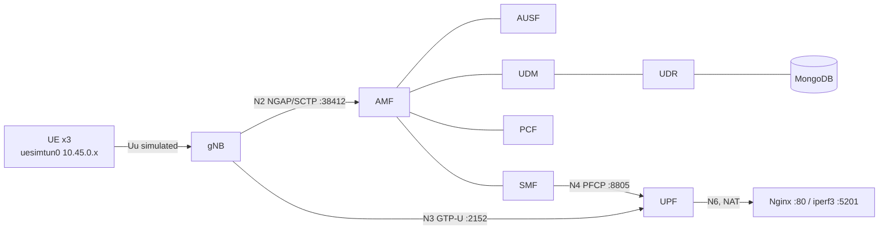

| Interface | Role | Protocol | Between |
|---|---|---|---|
| N2 | RAN control | NGAP / SCTP | gNB ↔ AMF |
| N3 | User-plane transport | GTP-U / UDP 2152 | gNB ↔ UPF |
| N4 | Session control | PFCP / UDP 8805 | SMF ↔ UPF |
| N6 | Data network | plain IP, NAT | UPF ↔ Nginx / iperf3 |
| SBI | Service bus | HTTP/2 | AMF, SMF, AUSF, UDM, UDR, PCF, NRF, SCP |

PLMN 999/70, TAC 1, slice SST 1 / SD 0xffffff, UE pool `10.45.0.0/16`, tunnel MTU 1400.

**Deployment choice.** All containers share one Docker bridge (`172.18.0.0/16`), a simplification inherited from the Gradiant base (alternative approaches are allowed by the assignment). The 5G procedures are unchanged; container IPs change on restart, so captures are filtered by port.

---

## 2. Step 1 — Deployment and end-to-end operation

Files: [`ngc.yaml`](ngc.yaml) (core), [`gnb1.yaml`](gnb1.yaml) (gNB + UEs), [`app.yaml`](app.yaml) (N6 services), [`register_subscriber.sh`](register_subscriber.sh).

```
uesimtun0: inet 10.45.0.2/32                       # PDU session established
$ ping -I uesimtun0 -c 4 8.8.8.8   → 0 % loss, avg 70 ms
$ curl --interface uesimtun0 http://nginx → HTTP 200
```

**Important:** UERANSIM does not change the UE container's default route. Only traffic bound to `uesimtun0` enters the 5G tunnel. An A/B test proves it:

| Test | Command | HTTP | Time | GTP-U packets on N3 |
|---|---|---|---|---|
| A — 5G path | `curl --interface uesimtun0 http://nginx` | 200 | 5.7 ms | **12** |
| B — Docker shortcut | `curl http://nginx` | 200 | 1.0 ms | **0** |

A successful response does not prove the path; only packet evidence on N3 does. Every test in this report is bound to the tunnel.

---

## 3. Step 2 — Traffic observation and 5G protocol behaviour

**Method:** NF logs during a triggered registration (`docker restart` of the UE container) plus `tcpdump` on the Docker bridge, filtered per interface (SCTP 38412, UDP 2152, UDP 8805, TCP 80/5201).

### 3.1 Registration and PDU session

| Step | Interface | Evidence |
|---|---|---|
| RRC Setup | Uu (simulated) | UE: `Sending RRC Setup Request` |
| Registration Request → AMF | N2 | AMF: `InitialUEMessage` |
| Authentication (AMF ↔ AUSF ↔ UDM ↔ UDR ↔ MongoDB) | SBI + N2 | UE: `Authentication Request received`, `Security Mode Command received` |
| Registration Accept | N2 | UE: `Initial Registration is successful` |
| PDU Session Request → SMF, IP assigned | N2 + SBI | SMF: `UE SUPI[imsi-...003] DNN[internet] IPv4[10.45.0.20]` |
| PFCP Session Establishment (uplink rules in UPF) | N4 | capture: 596 B request / 116 B response; UPF: `Number of UPF-Sessions is now 1` |
| PFCP Session Modification (gNB downlink endpoint) | N4 | capture: 75 B / 21 B |
| Tunnel up | — | UE: `TUN interface[uesimtun0, 10.45.0.20] is up` |

All within 18 ms (13:42:44.103 → .121 UTC). Raw log: [`evidence/registration-sequence-full.log`](evidence/registration-sequence-full.log).

### 3.2 N2, N4 and SBI

- **N2:** the SCTP association gNB ↔ AMF exists before any UE activity (heartbeats `HB REQ/ACK`); NGAP `DATA` chunks start at the exact time of `InitialUEMessage`; several SCTP streams are used in parallel (multi-streaming, no head-of-line blocking between UEs). [`evidence/n2-n3-n4-summary.txt`](evidence/n2-n3-n4-summary.txt)
- **N4:** one PFCP establishment + modification per UE; PFCP carries no user data, it only installs the UPF forwarding rules.
- **SBI:** six NFs register with the NRF (10 s heartbeat) and subscribe to notifications; the SMF delegates discovery to the SCP. UDR and PCF (MongoDB-dependent) register ~98 s later; meanwhile UDM → UDR discovery fails (`No NF-Instance [nudr-dr:UDM]`), then recovers on its own. [`evidence/sba-startup-2026-10-06.txt`](evidence/sba-startup-2026-10-06.txt)

### 3.3 N3 — GTP-U encapsulation

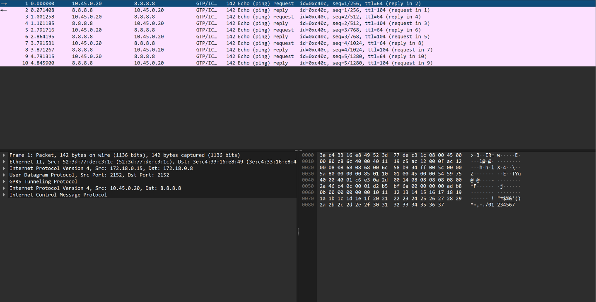

```
IP 172.18.0.15 (gNB) → 172.18.0.8 (UPF)     ← outer header, N3 transport
 └─ UDP 2152 └─ GTP-U
     └─ IP 10.45.0.20 (UE) → 8.8.8.8          ← the UE's own packet
         └─ ICMP
```

On the transport network only UDP between gNB and UPF is visible; the UE's addresses are hidden inside GTP-U. Five pings produced exactly 10 GTP-U packets ([`evidence/n3-summary.txt`](evidence/n3-summary.txt)).

### 3.4 N6 — TCP and UDP

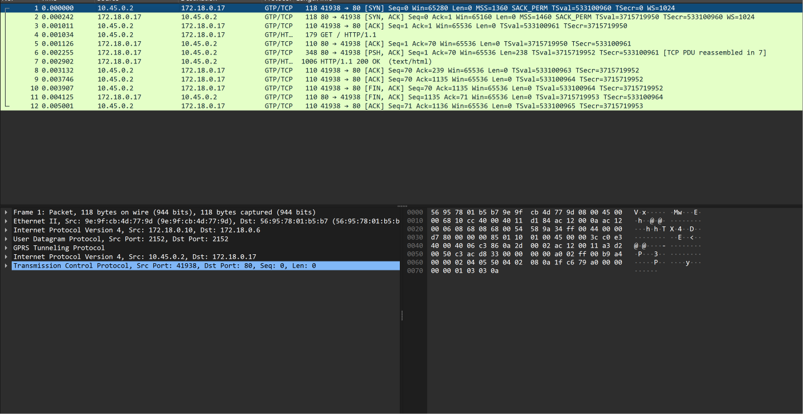

- **TCP/HTTP:** the 12 GTP-U packets of test A contain a full TCP connection (handshake, `GET`, `200 OK`, FIN). The UE advertises **MSS 1360** (tunnel MTU 1400) vs 1460 for Nginx: room is left for the GTP-U/UDP/IP outer headers, so no fragmentation.
- **UDP (iperf3, 5 Mbit/s):** 0 / 2318 datagrams lost, jitter 0.19 ms; **2349 packets on N3 and 2349 on N6** (one-to-one forwarding by the UPF). On N6 the server sees the UPF address, not `10.45.0.2`: **NAT**. [`evidence/n6-udp-iperf3.txt`](evidence/n6-udp-iperf3.txt)

---

## 4. Step 3 — Measurement, degradation and analysis

### 4.1 Method

| Level | Test (per repetition, 3 repetitions per condition) |
|---|---|
| Network | 50 pings UE → Nginx via `uesimtun0` |
| Transport | iperf3 TCP downlink 10 s; iperf3 UDP downlink 10 s at 10 Mbit/s (30 Mbit/s for rate tests) |
| Application | 20 HTTP requests to Nginx |

- [`scripts/measure.py`](scripts/measure.py) runs the tests, checks the tunnel before/after each repetition (auto-restarts the UE if dead), writes [`results/dataset.csv`](results/dataset.csv) (long format) and pushes to Prometheus.
- [`scripts/impair.sh`](scripts/impair.sh) applies `tc`/NetEm, logged in [`results/impairments.log`](results/impairments.log):
  - **N3:** UPF `eth0` egress, a `prio` qdisc + `u32` filter sends **only UDP dport 2152** (downlink GTP-U) to NetEm — N4 and N6 untouched.
  - **N6:** egress of the Nginx and iperf3 containers.
- Validation: RTT 2.59 → 53.18 ms (+50 ms N3) and 53.50 ms (+50 ms N6); the N3 filter structure alone costs ~5 % and drops nothing.
- [`scripts/run_campaign.sh`](scripts/run_campaign.sh): 7 Oct 2026, 12:28–12:46 UTC, 9 conditions, impairments cleared between conditions, `systemd-timesyncd` stopped and clock monitored (0 clock jumps, 0 radio failures — see §5.2). Log: [`results/campaign.log`](results/campaign.log).
- [`scripts/analyze.py`](scripts/analyze.py): mean ± std, HTTP median/mean/p95 → [`results/summary.md`](results/summary.md), [`results/figures/`](results/figures/).

### 4.2 Results

Mean ± std over 3 repetitions; HTTP over 60 requests. HTTP success was 100 % in every condition.

| Condition | Loc. | RTT (ms) | TCP (Mbit/s) | TCP retr. | UDP offered / delivered | UDP loss (%) | Jitter (ms) | HTTP median / mean / p95 (ms) |
|---|---|---|---|---|---|---|---|---|
| baseline | — | 3.07 ± 0.12 | 1,056.6 ± 0.5 | 1,411 | 10 / 10.00 | 0.00 | 0.076 | 1.58 / 1.83 / 2.24 |
| delay 50 ms | N3 | 53.69 ± 0.09 | 23.7 ± 1.3 | 360 | 10 / 10.00 | 0.00 | 0.079 | 106.03 / 105.98 / 108.58 |
| delay 50 ms | N6 | 53.89 ± 0.15 | 130.4 ± 44.4 | 382 | 10 / 10.00 | 0.00 | 0.053 | 107.05 / 106.77 / 108.90 |
| loss 1 % | N3 | 2.63 ± 0.41 | 235.2 ± 7.1 | 2,202 | 10 / 9.91 | 0.95 | 0.051 | 1.49 / 22.12 / 2.84 |
| loss 1 % | N6 | 3.01 ± 0.17 | 685.2 ± 28.5 | 5,904 | 10 / 9.90 | 0.97 | 0.051 | 1.48 / 18.36 / 1.89 |
| baseline | — | 2.33 ± 0.24 | 1,056.5 ± 0.6 | 1,213 | 30 / 30.00 | 0.00 | 0.034 | 1.53 / 1.59 / 1.88 |
| rate 20 Mbit/s | N3 | 2.39 ± 0.68 | 18.5 ± 0.0 | 0 | 30 / 20.52 | 31.60 | 0.153 | 2.33 / 2.37 / 2.85 |
| rate 20 Mbit/s | N6 | 2.65 ± 0.18 | 19.1 ± 0.0 | 0 | 30 / 21.06 | 29.79 | 0.161 | 2.05 / 2.11 / 2.57 |
| recovery | — | 2.76 ± 0.45 | 1,054.1 ± 2.5 | 1,098 | 10 / 10.00 | 0.00 | 0.057 | 1.60 / 1.70 / 2.55 |

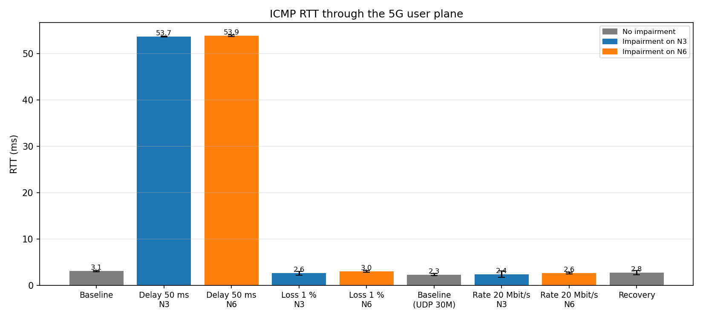
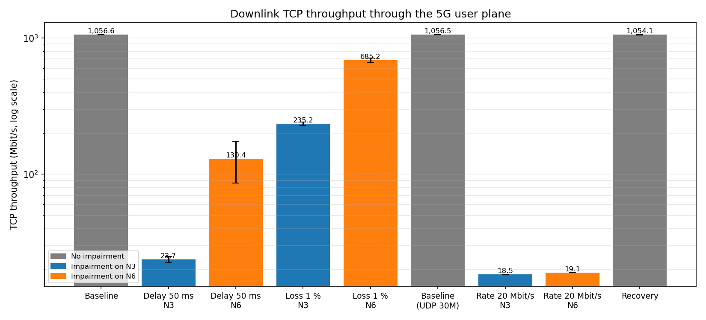
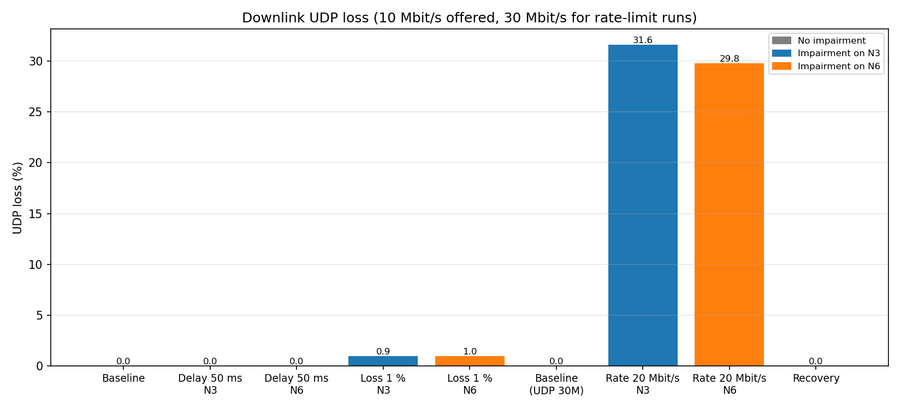
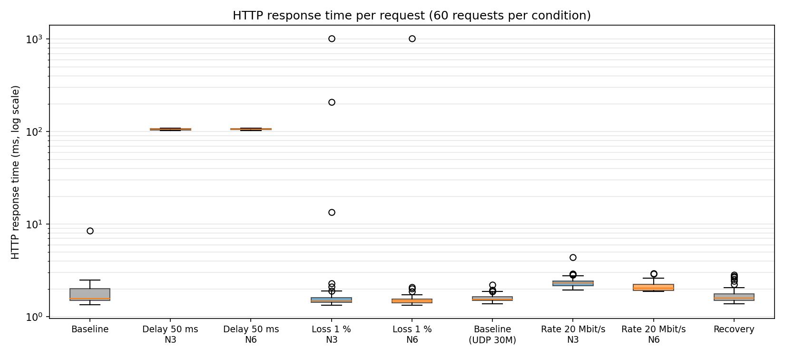
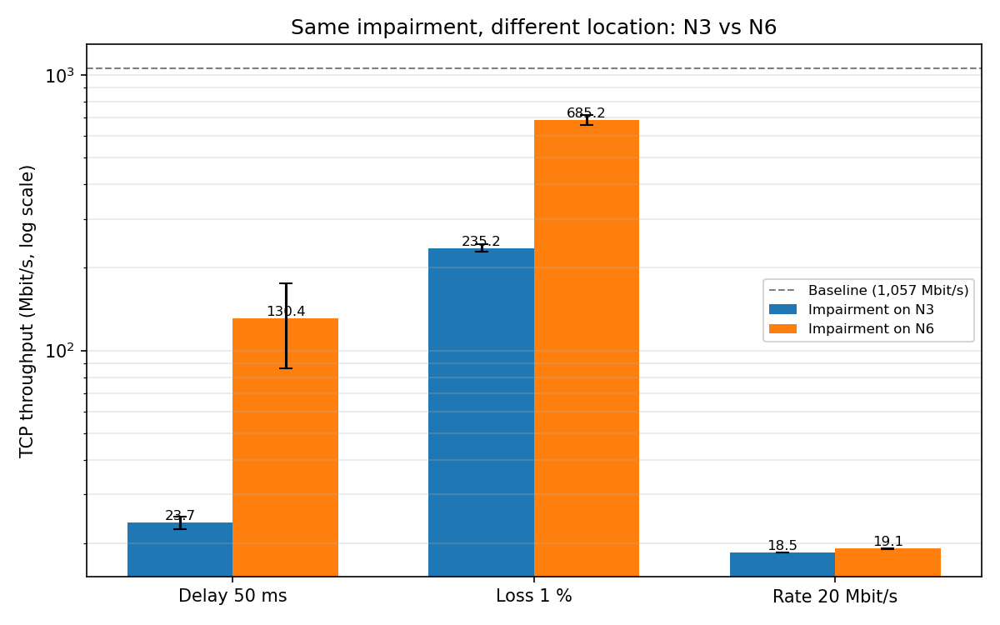

### 4.3 Interpretation

**Baseline.** RTT ~3 ms (20× Scenario A, because the gNB and UPF process every packet in user space); TCP ~1.06 Gbit/s, the real capacity of the software user plane; ~1,100–1,400 retransmissions per test even without impairment (TCP saturates the user-space path). The recovery run matches the baseline: no lasting effect.

**Delay 50 ms.** RTT +50.6 / +50.8 ms (delay on downlink only, so added once per round trip). UDP unaffected (a constant delay neither drops nor slows a fixed-rate flow). TCP collapses (24 / 130 Mbit/s): at 54 ms RTT, the window must grow one round trip at a time and every loss costs a 54 ms recovery. **HTTP +104 ms = 2 round trips** (TCP handshake 0.9 → 52.7 ms, then request/response).

**Loss 1 %.** UDP loses 0.95–0.97 % — no retransmission. TCP repairs every loss (duplicate ACKs, fast retransmission) at the cost of throughput (235 / 685 Mbit/s). HTTP median unchanged, but the mean rises because of three requests sitting exactly on TCP timers: **~1,010 ms** (lost SYN-ACK → SYN retried after 1 s) and **210 ms** (lost data segment → 200 ms minimum RTO).

**Rate 20 Mbit/s.** TCP 18.5 (N3) / 19.1 (N6) Mbit/s, no retransmission. NetEm limits frame bytes, iperf3 counts payload: N3 = 1,348 payload bytes per ~1,450-byte frame (GTP-U + smaller MTU) → 18.6; N6 = 1,448 / 1,514 → 19.1. UDP at 30 Mbit/s loses ~30 % deterministically (queue overflow), jitter rises with queueing. Pings and HTTP, run alone, are almost unaffected.

**N3 vs N6.** Same RTT, UDP, HTTP latency and availability at both locations; **TCP differs under delay (24 vs 130) and loss (235 vs 685)**. On N6, the server sends aggregated frames up to 42 KB (segmentation offload, [screenshot](evidence/wireshark-n6-aggregated-frames.png)); on N3 the UPF sends individual ~1,450-byte GTP-U packets. "1 % loss" therefore means fewer but larger loss events on N6 — more retransmitted segments, but fewer window reductions, so higher throughput.
*Open question:* the ~24 Mbit/s under delay on N3 is not explained — NetEm drops nothing there, and the filter structure was ruled out by a control test. The losses probably occur in user-space processing (UPF / gNB); locating them would need per-stage drop counters.

**Application impact.** The service stayed 100 % available in every condition. Delay is felt directly; loss is mostly hidden by TCP except in the tail; a rate limit only matters for bulk transfers.

### 4.4 Packet evidence — a loss located at the UPF

3 s TCP downlink with 1 % loss on N3, captured on N3 and N6 simultaneously ([`results/capture-n3-n6-loss1pct.pcap`](results/capture-n3-n6-loss1pct.pcap)); iperf3: 222 Mbit/s, 663 retransmissions.

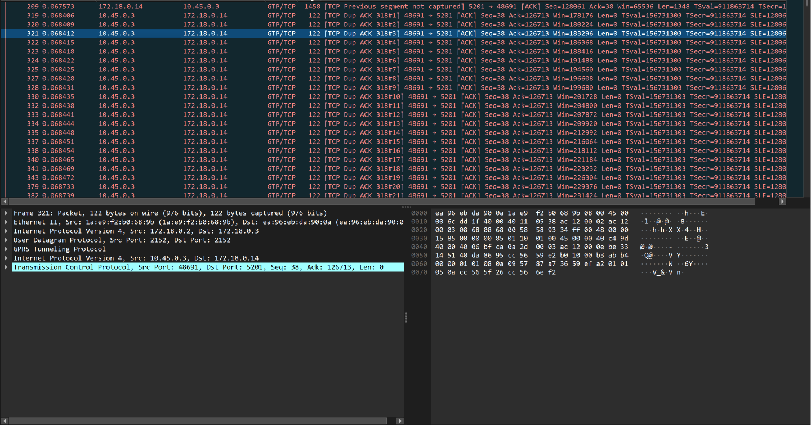
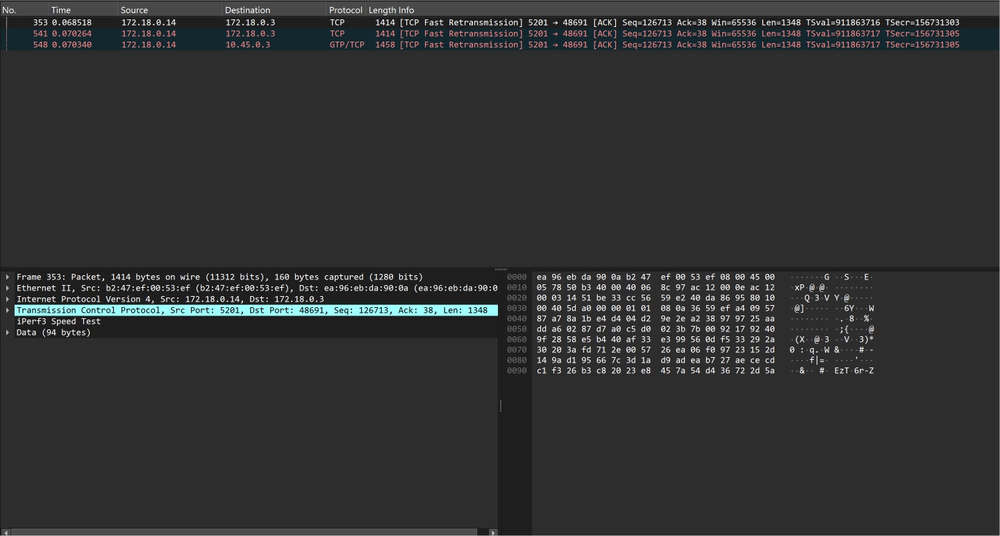

| Transmission of segment Seq 126713 | N6 (before UPF) | N3 (after UPF) |
|---|---|---|
| Original | present (inside aggregated frame) | **absent** |
| 1st fast retransmission | present | **absent** |
| 2nd fast retransmission | present | present — delivered |

Inside the tunnel the UE sends 21+ duplicate ACKs with SACK. The segment was lost twice between N6 and N3, i.e. at the UPF egress where the impairment is applied: configured condition → packet behaviour → transport reaction → measured throughput.

### 4.5 Prometheus and Grafana

Open5GS metrics (AMF, SMF, UPF, PCF), measurement results (Pushgateway) and VM CPU (cAdvisor) are scraped every 5 s and shown in one dashboard: configured impairment, RTT, TCP throughput, loss, retransmissions, HTTP time, UE/PDU-session state and procedure counters. Config: [`monitoring.yaml`](monitoring.yaml), [`monitoring/`](monitoring/).

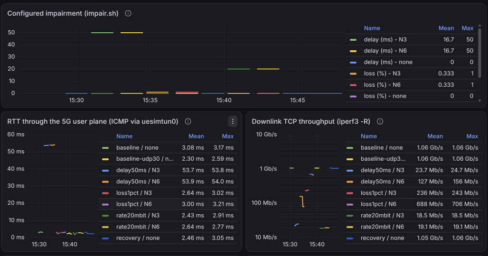
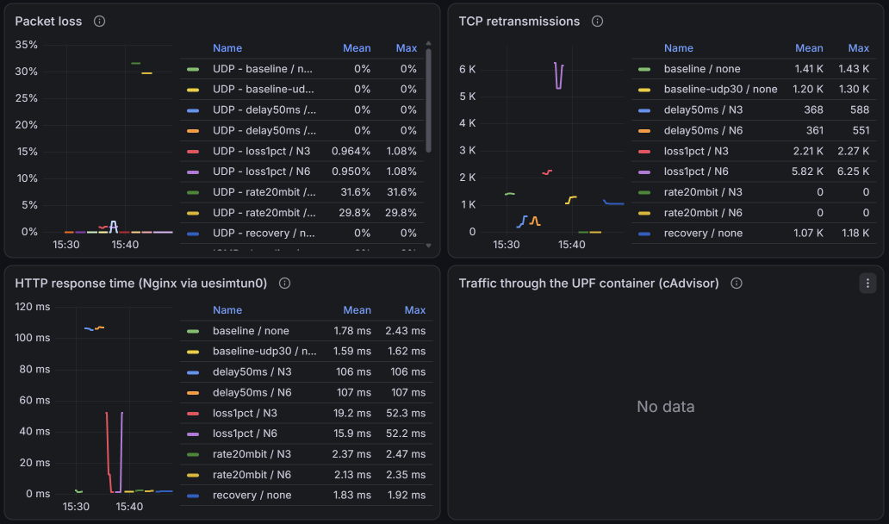
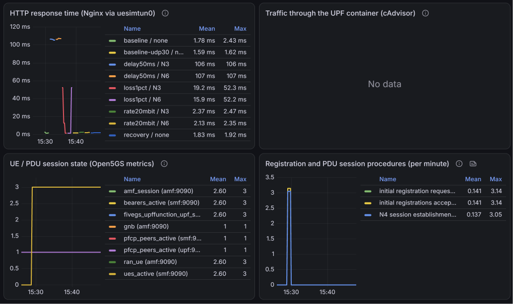

Each impairment window lines up with the change in the measurement panels, and everything returns to baseline afterwards. The UE/PDU panel shows **0 UEs** in the core before 12:28 UTC (while `uesimtun0` was still UP in the container), then 3 registrations and 3 N4 establishments: the automatic UE recovery of §5.2 seen from the core. (Screenshots are in UTC+3.)

---

## 5. Diagnosed failures

**5.1 MongoDB without restart policy.** After a WSL restart, UDR and PCF looped on `Failed to connect to server [mongodb://mongo/open5gs]`: `mongo` (and `gnb1`/`ues1`) was the only service without `restart: on-failure`, so it stayed down. Fix: restart it and add the policy. Verified by a full new registration.

**5.2 Radio-link failures caused by WSL2 clock steps.**

| | Evidence |
|---|---|
| Symptom | 100 % ping loss through `uesimtun0`, while every container was `Up` and `uesimtun0` still UP — interface state is not path evidence |
| Component | simulated radio link: UE `Radio link failure detected`, gNB `UE signal lost`; core healthy |
| No self-recovery | gNB keeps the old context: `Discarding RRC Setup Request, UE context already exists`, UE gives up (`T3517 expired`); only a UE restart fixes it |
| False suspect | the N3 impairment — applied 61 s *after* the first failure |
| Root cause | [`clock_monitor.py`](scripts/clock_monitor.py) shows a wall-clock step of **+1.1–1.25 s every ~33 s** (`systemd-timesyncd` stepping a drifting VM clock); each failure coincides with a step to within 0.2 s |
| Correction | timesyncd stopped during measurements, clock monitored, automatic UE recovery → 0 clock jumps, 0 failures during the campaign |

---

## 6. Limitations

- Single Docker bridge: impairments are scoped by port filter (N3) or on the server containers (N6), downlink only.
- Shared WSL2 VM: absolute throughputs reflect this machine's user-space capacity; 3 repetitions only (large spread on delay/N6).
- cAdvisor exposes only VM-level CPU here; UPF N3 packet counters stay at 0 and are not used.
- Open question on TCP under delay on N3 (§4.3).

Observation methods used: packet captures (protocol behaviour, loss location), NF logs (procedures, failure causes), active measurements (performance), Prometheus/Grafana (time correlation with 5G state). Their individual limits are detailed in [REPORT-detailed.md §6](REPORT-detailed.md#6-observation-methods-purpose-and-limitations).

---

## 7. Conclusion

A complete 5G SA network was deployed, its control-plane and user-plane procedures were observed on every interface (N2, N3, N4, N6, SBI), and a reproducible campaign quantified the effect of delay, loss and rate limitation at two locations, with a dataset, Python analysis, a Grafana dashboard and packet-level proof of where a loss occurs. Delay dominates the user experience, TCP masks loss at the cost of throughput, protocol overhead explains rate-limited throughput, and the impairment location matters for TCP because of how packets are grouped on each interface.

---

## Reproduce

```bash
export COMPOSE_PROJECT_NAME=open5gs-and-ueransim
sudo modprobe sctp
docker compose -f ngc.yaml up -d && ./register_subscriber.sh
docker compose -f gnb1.yaml up -d
docker compose -f app.yaml up -d
docker compose -f monitoring.yaml up -d
docker exec open5gs-and-ueransim-ues1-1 ping -I uesimtun0 -c 4 nginx     # check the tunnel

cd scripts
./run_campaign.sh 2>&1 | tee ../results/campaign.log   # ~20 min, needs sudo
python3 analyze.py
```

Grafana: http://localhost:3000 (admin / admin).
